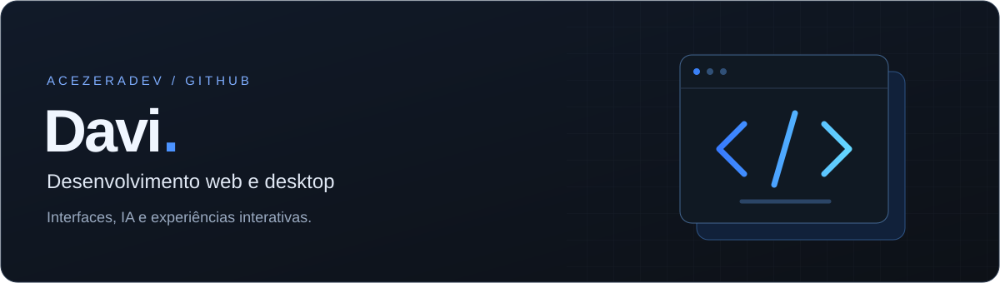
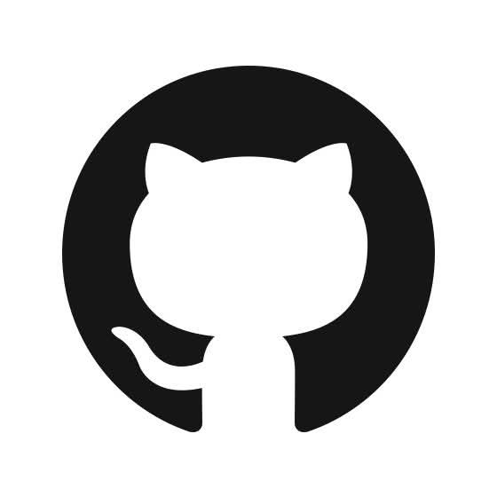
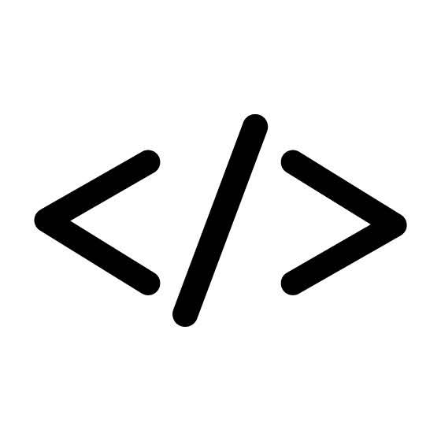
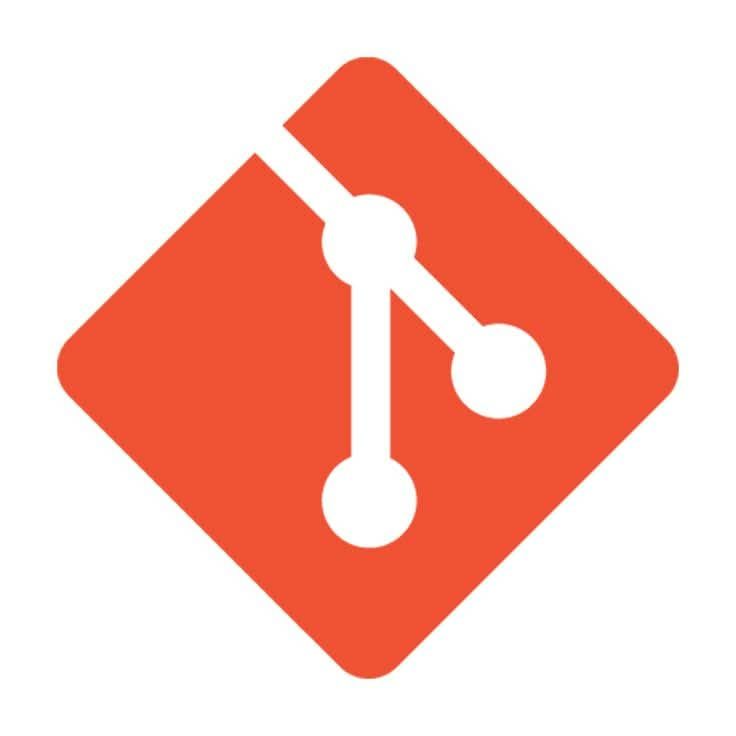
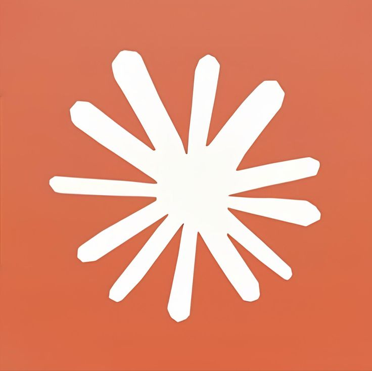

  

  <a href="https://minerva-liart.vercel.app"><b>Conheça o Minerva ↗</b></a> &nbsp; · &nbsp; <a href="https://github.com/AcezeraDev?tab=repositories"><b>Explore meus projetos ↗</b></a>

 

 
 

<b>Código, versionamento e IA</b>

   &nbsp; &nbsp;
   &nbsp; &nbsp;
   &nbsp; &nbsp;
  

GitHub &nbsp; · &nbsp; Código &nbsp; · &nbsp; Git &nbsp; · &nbsp; Claude

 

  
  

  
  

  <b>Veja no navegador</b> 
  <a href="https://minerva-liart.vercel.app">Minerva ↗</a> &nbsp; · &nbsp; <a href="https://site-beta-eight-21.vercel.app">China Glass ↗</a> &nbsp; · &nbsp; <a href="https://alquiverde-kits-presente.vercel.app">AlquiVerde ↗</a>

 

Interfaces, ferramentas e experiências feitas para sair da ideia e ganhar vida.

